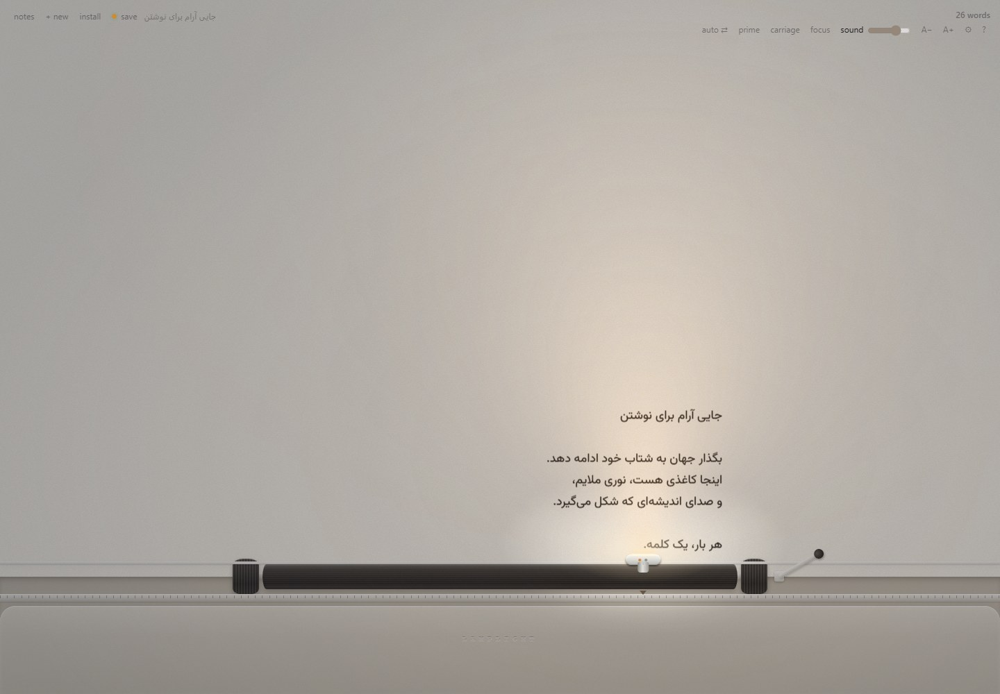

# ماشین تایپ · Digital Ink

محیطی آرام برای نوشتن یادداشت‌های فارسی و انگلیسی، با ظاهر ماشین‌تحریر، نور ملایم، کاغذ گرم و صدای کلیدها.

**وب‌سایت:** [ialirezaaa.github.io/typing-machine](https://ialirezaaa.github.io/typing-machine/)

[English](README.md) · [مجوز MIT](LICENSE)



## امکانات

- تشخیص خودکار جهت متن و نمایش پیوستهٔ حروف فارسی
- چند یادداشت، سنجاق کردن، جست‌وجو و کشوی یادداشت‌ها
- ذخیرهٔ خودکار در مرورگر، حالت تمرکز و تنظیم اندازه و نوع قلم
- صدای تایپ اختیاری و حرکت مکانیزم ماشین‌تحریر
- عنوان‌ها، نقل‌قول‌ها، فهرست‌ها و چک‌باکس‌های ساده
- خروجی متن و Markdown، پشتیبان‌گیری و ورود یادداشت‌ها با JSON
- فونت‌های محلی و اجرای آفلاین پس از نصب موفق سرویس‌ورکر

## نسخهٔ عمومی سایت · GitHub Pages

این برنامه بدون نیاز به سرور یا مرحلهٔ ساخت، مستقیماً از ریپوی گیت‌هاب قابل انتشار است.

**آدرس سایت:** https://ialirezaaa.github.io/typing-machine/

GitHub Pages فعال شده و انتشار اولیه با موفقیت انجام شده است. نسخهٔ سایت مستقیماً از شاخهٔ **main** و پوشهٔ **/(root)** منتشر می‌شود و تغییرات بعدی شاخهٔ main نیز به‌صورت خودکار روی سایت اعمال می‌شوند.

نسخهٔ آنلاین و نسخهٔ محلی، حافظهٔ مرورگر جداگانه دارند. برای انتقال یادداشت‌ها از نسخهٔ قبلی، خروجی پشتیبان JSON بگیرید و در سایت وارد کنید. سایت برای اجرا به `serve.py` نیاز ندارد و یادداشت‌های شما را روی سرور ذخیره نمی‌کند.

## نصب روی گوشی و استفاده بدون اینترنت

نسخهٔ آنلاین روی آیفون، آیپد و گوشی‌های اندرویدی پشتیبانی‌شده قابل نصب است. فایل‌های لازم برنامه، شامل HTML، فونت‌ها، آیکون‌ها و فایل‌های رابط، برای اجرای آفلاین روی دستگاه ذخیره می‌شوند.

1. **با اینترنت فعال** وارد [سایت ماشین تایپ](https://ialirezaaa.github.io/typing-machine/) شوید.
2. **آیفون و آیپد:** در **Safari** روی **Share → Add to Home Screen → Add** بزنید. **اندروید:** در Chrome گزینهٔ **Install app** یا **Add to Home screen** را انتخاب کنید.
3. برنامه را از **آیکون صفحهٔ اصلی گوشی** یک‌بار با اینترنت باز کنید و تا نمایش عبارت **offline ready** در گوشهٔ پایین صفحه بمانید.
4. **حالت پرواز** را روشن کنید، برنامه را ببندید و دوباره از آیکونش باز کنید. می‌توانید بدون اینترنت یادداشت بنویسید. عبارت **working offline** نشان داده می‌شود.

اگر وضعیت **offline not ready** بود، به اینترنت وصل شوید و از **Help → Check / repair** استفاده کنید. برنامه در هر اجرا فایل‌های لازم را بررسی می‌کند و در صورت امکان فایل‌های حذف‌شده را دوباره ذخیره می‌کند. سیستم‌عامل ممکن است در اثر کمبود فضای ذخیره‌سازی، کش برنامه را حذف کند؛ بنابراین دسترسی آفلاین همیشگی و تضمین‌شده نیست.

یادداشت‌ها **فقط روی همان دستگاه و در حافظهٔ مرورگر** ذخیره می‌شوند؛ روی GitHub یا سرور آپلود نمی‌شوند. نسخهٔ نصب‌شده و Safari ممکن است حافظهٔ جداگانه داشته باشند و همگام‌سازی خودکار وجود ندارد. مرتب از بخش **Save & backup → JSON** نسخهٔ پشتیبان بگیرید.

## نسخهٔ Digital Ink برای گوشی

نسخهٔ موبایل دارای آرشیو خوانا و قابل لمس است؛ صفحهٔ **Save & backup** در گوشی قابل پیمایش شده و برای ذخیرهٔ فایل در آیفون از **Share / Save to Files** استفاده می‌شود. نام نمایشی برنامه از Lamplight به **Digital Ink** تغییر کرده ولی کلیدهای ذخیرهٔ قبلی حفظ شده‌اند تا یادداشت‌ها حذف نشوند.

برای بررسی نسخهٔ نهایی جدید، از **Help → Check for updates** استفاده کنید. پس از آماده‌شدن فایل‌ها، دکمهٔ **Install ready update** یا **update** را بزنید. هنگام تایپ، برنامه بدون اجازهٔ شما ری‌لود نمی‌شود.

نسخهٔ آمادهٔ انتشار در پوشهٔ [`dist/`](dist) قرار دارد. با `node scripts/build.mjs` دوباره ساخته و با `node scripts/build.mjs --check` بررسی می‌شود. راهنمای کامل در [docs/releasing.md](docs/releasing.md) است.

## اجرا

فایل `index.html` را در مرورگر باز کنید. برای نصب به‌شکل برنامه و استفاده از کش آفلاین، با Python 3 اجرا کنید:

```sh
python serve.py
```

سپس آدرس **http://127.0.0.1:8765/** را باز کنید. سرور فقط روی همین رایانه در دسترس است. در ویندوز، `TypingMachine.bat` کروم را به‌شکل پنجرهٔ برنامه باز می‌کند و اگر Python را پیدا کند، سرور محلی را راه می‌اندازد.

## میانبرها

| کلید | کارکرد |
| --- | --- |
| Ctrl+K | کشوی یادداشت‌ها |
| Alt+N | یادداشت تازه |
| Ctrl+F | جست‌وجو در متن |
| Ctrl+S | پنل خروجی و ورود فایل |
| Ctrl+Shift+S | پشتیبان همهٔ یادداشت‌ها |
| Ctrl+. | حالت تمرکز |
| Ctrl+; | روشن و خاموش کردن صدا |
| Alt+R | تغییر جهت نوشتن |
| Ctrl+/ | راهنما و سایر میانبرها |

در مک از Command به‌جای Ctrl استفاده کنید.

## نگهداری یادداشت‌ها

یادداشت‌ها در حافظهٔ محلی همین مرورگر ذخیره می‌شوند. برنامه همگام‌سازی ابری یا ابزار تحلیل رفتار ندارد. مرورگرها، پروفایل‌ها و آدرس‌های مختلف فضای ذخیره‌سازی جدا دارند. پاک کردن داده‌های سایت می‌تواند یادداشت‌ها را حذف کند؛ مرتب از همهٔ یادداشت‌ها پشتیبان JSON بگیرید.

برای سازگاری با نسخهٔ قبلی Lamplight، کلیدهای ذخیره‌سازی و قالب پشتیبان قبلی حفظ شده‌اند. راه‌انداز ویندوز انتقال یک‌بارهٔ یادداشت‌های نسخهٔ فایل به سرور محلی را پشتیبانی می‌کند. نسخه‌های قدیمی، فایل‌های انتقال و یادداشت‌های شخصی در مخزن منتشر نمی‌شوند. متن تصاویر، نمونه است.

## مشارکت و مجوز

گزارش اشکال و Pull Request خوش‌آمد است. نام مرورگر، سیستم‌عامل و مراحل بازتولید را بنویسید و از متن نمونه استفاده کنید.

کد برنامه با [مجوز MIT](LICENSE) منتشر شده است. مجوزهای جداگانهٔ فونت‌ها در [اعلان‌های شخص ثالث](THIRD_PARTY_NOTICES.md) آمده‌اند.
