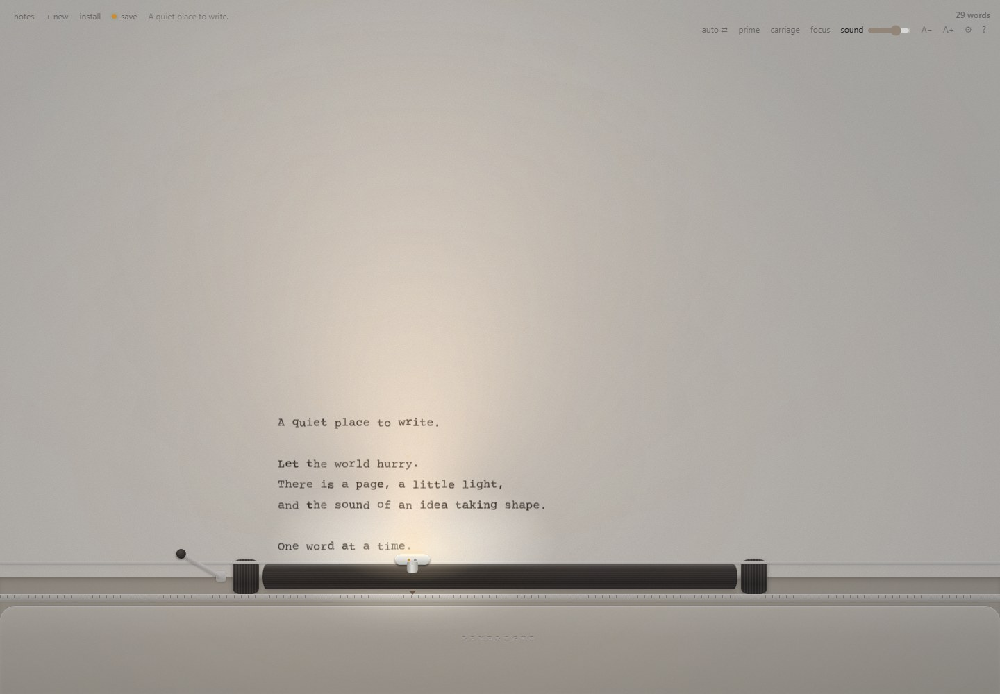
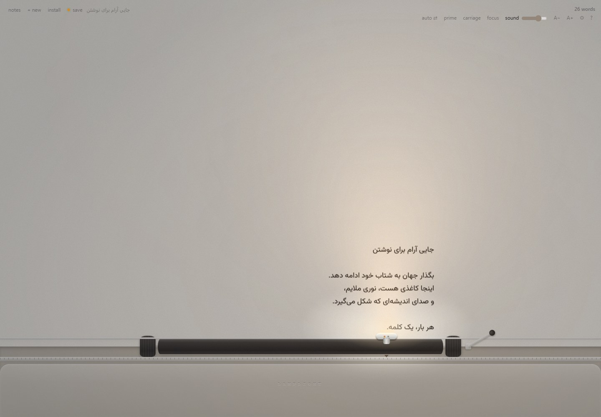

# Typing Machine · ماشین تایپ

A quiet, vintage-inspired typewriter for Persian and English notes. Warm paper, a moving carriage, a soft pool of light, and mechanical key sounds — in your browser.

**Website:** [ialirezaaa.github.io/typing-machine](https://ialirezaaa.github.io/typing-machine/) *(available after GitHub Pages is enabled)*

[راهنمای فارسی](README.fa.md) · [MIT license](LICENSE)



## Features

- Persian and English writing with automatic text direction and joined Persian letters.
- Multiple notes, pinned notes, search, and a paper-folder archive.
- Automatic saving in your browser, focus mode, adjustable type size, and optional typing sounds.
- Lightweight Markdown-style headings, quotes, lists, and checkboxes.
- Export text or Markdown; back up and import all notes as JSON.
- Bundled fonts and offline support after the first successful service-worker installation.
- Installable as a standalone web app in supported browsers. No account or build step required.

## Public website · GitHub Pages

The web app runs directly from this repository, without a build step or a backend.

**Public URL (once GitHub Pages is enabled):** https://ialirezaaa.github.io/typing-machine/

To enable it once, open [Repository Settings → Pages](https://github.com/iAlirezaaa/typing-machine/settings/pages) and select **Deploy from a branch** → **main** → **/(root)** → **Save**. GitHub Pages then publishes the existing `index.html` and deploys updates whenever `main` changes. The `.nojekyll` file keeps the site as plain static assets.

The website and the local launcher have **separate browser storage**. To move writing from localhost or a file-based version, export a JSON backup in the old version and import it on the website. The hosted version does not use `serve.py` or transfer notes to a server.

## Run locally

Download or clone this repository, then open `index.html` in a modern browser. For installation and offline caching, use Python 3:

```sh
git clone https://github.com/iAlirezaaa/typing-machine.git
cd typing-machine
python serve.py
```

Open **http://127.0.0.1:8765/**. The server listens only on your computer. On Windows, `TypingMachine.bat` opens Chrome in an app window and starts the local server when it finds Python. `Lamplight.bat` is kept for older shortcuts.

The app can also be served by a static web host over HTTPS. Installation availability depends on the browser.

## Keyboard shortcuts

Use Command instead of Ctrl on macOS.

| Shortcut | Action |
| --- | --- |
| Ctrl+K | Notes drawer |
| Alt+N | New note |
| Ctrl+F | Find in current note |
| Ctrl+S | Export / import panel |
| Ctrl+Shift+S | Back up all notes |
| Ctrl+. | Focus mode |
| Ctrl+; | Toggle sound |
| Ctrl+, | Mechanism settings |
| Alt+R | Change text direction |
| Alt+T | Change typeface |
| Ctrl+/ | Help and more shortcuts |

## Persian writing



## Your notes

Notes and settings are stored in this browser's local storage. There is no cloud sync or analytics in the app. Different browsers, profiles, and website addresses have separate storage. Clearing site data can erase your notes, so export a JSON backup regularly.

For users of the original Lamplight file version, the Windows launcher supports a one-time transfer to the local server. The `lamplight.*` storage keys and JSON backup format are retained for compatibility. Local migration files, historical snapshots, and personal backups are excluded from this repository. Screenshots show fictional sample text.

## Project layout

- `index.html`: interface, styles, editor, and generated typing sounds.
- `fonts/`: local fonts and their licenses.
- `icons/`, `manifest.webmanifest`, `sw.js`: install and offline assets.
- `serve.py`: optional local server and legacy-note migration.
- `docs/screenshots/`: actual application screenshots.

## Contributing and license

Bug reports and pull requests are welcome. Include your browser, operating system, and steps to reproduce; use sample notes rather than private writing.

Application code: [MIT](LICENSE). Fonts retain their original licenses; see [third-party notices](THIRD_PARTY_NOTICES.md).
